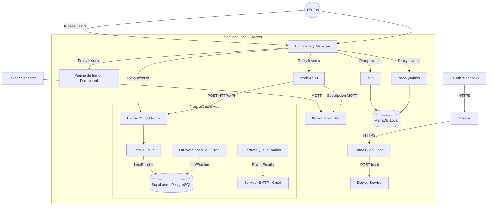

# Arquitectura y Flujo de Datos

El servidor central funciona sobre un entorno **Dockerizado (Docker Compose)**, que orquesta múltiples servicios interconectados.

## 1. Esquema General de Arquitectura

## 2. Descripción de Componentes

### Dispositivos IoT
*   **ESP32**: Microcontroladores ubicados en los freezers. Se encargan de sensar la temperatura y el estado de la tensión eléctrica (batería), y publican estas métricas en tiempo real.

### Ingreso de Datos (IoT)
*   **Mosquitto (Broker MQTT)**: Servidor liviano que recibe todos los mensajes publicados por los ESP32.
*   **Node-RED**: Funciona como un middleware lógico. Se suscribe a los tópicos de Mosquitto, formatea los datos y hace una petición HTTP POST a la API de FreezerGuard para inyectar las mediciones.

### Aplicación Principal (FreezerGuard)
El core está desarrollado en **Laravel (PHP)** y dividido en múltiples contenedores para escalar responsabilidades:
*   **FreezerGuard (App / Nginx)**: Sirve la aplicación web, la interfaz gráfica y expone la API (`/api/iot/data`) protegida con una API Key (`NODERED_API_KEY`).
*   **FreezerGuard Scheduler**: Ejecuta tareas programadas (`cron`), específicamente el comando `ProcessPendingAlerts` que revisa si hay alertas sin enviar.
*   **FreezerGuard Worker**: Procesa tareas en segundo plano (colas), como el envío asíncrono de correos electrónicos para no bloquear la ejecución de la aplicación.
*   **Supabase (PostgreSQL)**: Toda la persistencia principal de la aplicación (usuarios, freezers, muestras, mediciones y alertas) se almacena externamente en Supabase, no en bases de datos locales.

### Despliegue Continuo (CI/CD)
*   **Smee Client & Deploy Service**: Para automatizar el despliegue cuando hay cambios en el código de GitHub. GitHub envía un webhook a **smee.io** (un proxy público en la nube), el cual es escuchado por el contenedor `smee-client` alojado en el servidor local de forma constante. Este último reenvía la petición al `deploy-service`, el cual dispara los scripts de actualización (`FreezerGuard.ps1` u otros shell scripts) para volver a construir los contenedores y actualizarlos automáticamente.

### Servicios Adicionales & Gestión
*   **Nginx Proxy Manager**: Maneja los certificados SSL (Let's Encrypt) y enruta el tráfico web entrante hacia el contenedor interno correspondiente dependiendo del subdominio al que se ingresa.
*   **Tailscale**: Red privada virtual (VPN) de tipo malla que asegura que servicios críticos y paneles de control no estén expuestos directamente a internet público, permitiendo a los administradores un acceso remoto totalmente seguro.
*   **MariaDB & phpMyAdmin**: Base de datos relacional local que, en esta arquitectura, se utiliza exclusivamente para guardar el estado y las configuraciones de herramientas satélite (como n8n) y no los datos de la app.
*   **n8n**: Plataforma de automatización de flujos de trabajo instalada para integrar otros servicios o APIs en el futuro de forma visual.

---

## 3. Flujo Detallado de Datos (De la Medición a la Alerta)

1.  **Captura**: El ESP32 sensa la temperatura actual del freezer y comprueba si hay suministro eléctrico (mediante estado de batería).
2.  **Transmisión MQTT**: El ESP32 envía un mensaje con formato JSON a Mosquitto.
3.  **Procesamiento y Redirección**: Node-RED captura el mensaje de Mosquitto y dispara un `POST` seguro a la ruta `/api/iot/data` de Laravel.
4.  **Almacenamiento y Validación (Laravel + Supabase)**:
    *   Laravel recibe y valida los campos del request.
    *   `TelemetryService` procesa la medición y la persiste en **Supabase**.
    *   Compara la temperatura de la medición actual contra los márgenes (temperatura máxima y mínima) configurados en todas las *Muestras* vinculadas a ese freezer. Además, revisa la posible caída de tensión eléctrica.
    *   Si algún valor rebasa los umbrales de seguridad, registra en Supabase una `AlertaGenerada` inicializada con estado = `0` (Pendiente de Envío).
5.  **Despacho Asíncrono de Alertas**:
    *   El contenedor `freezerguard-scheduler` corre continuamente de fondo. De forma programada, invoca el comando `ProcessPendingAlerts`.
    *   La base de datos (Supabase) es consultada para traer todas las alertas con estado inferior a `2` (no resueltas).
    *   Se extraen los emails de todos los responsables/administradores del freezer y de las muestras asociadas.
    *   Se genera un trabajo (Job) y se deposita en la cola, el cual incluye el texto del correo y una URL firmada de forma criptográfica para resolver la alerta al hacer click.
6.  **Ejecución del Envío**:
    *   El contenedor `freezerguard-worker` procesa la cola vaciándola paso a paso; despacha cada correo utilizando el servidor SMTP externo (Gmail).
    *   Una vez despachado satisfactoriamente, el estado de esa `AlertaGenerada` se actualiza a `1` (Enviada) en Supabase para no volver a notificar.
